# Multi-AI-Profile (`multi-AI-profile`)

**Run multiple isolated Claude Desktop, Google Antigravity, OpenAI Codex / ChatGPT, xAI Grok, Cursor, and Windsurf accounts on macOS with custom window names, badged Dock icons, separate MCP/CLI configs, and zero disk overhead.**

Instant APFS copy-on-write macOS bundle cloner and native Mach-O `execv()` launcher that isolates Electron UI storage, background Go/Rust daemons, CLI homes (`CLAUDE_CONFIG_DIR`, `--gemini_dir`, `CODEX_HOME`, `GROK_HOME`), MCP configs, and AltTab/Mission Control window names.

<p align="left">
  
  
  
  
  
</p>

<p align="center">
  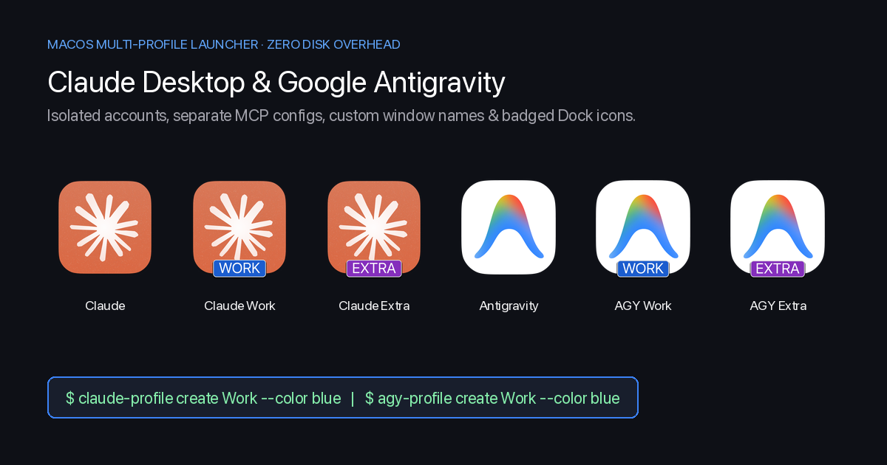
</p>

---

## 1. Nhu cầu thực tế & Vấn đề (The Problem)

Khi sử dụng các ứng dụng AI Desktop trên macOS (**Claude Desktop**, **Google Antigravity**, **OpenAI Codex / ChatGPT**, **xAI Grok**, **Cursor**, **Windsurf**...), rất nhiều kỹ sư và người dùng gặp chung 3 nhu cầu thực tế:

1. **Chạy song song nhiều tài khoản (Multi-Account):**
   - **Profile 1 (Bản gốc):** Tài khoản Cá nhân (Personal).
   - **Profile 2 (`Work`):** Tài khoản Công ty (Team / Enterprise).
   - **Profile 3 (`Extra`):** Tài khoản phụ cho dự án khách hàng hoặc tránh chạm rate-limit khi đang code dở.
2. **Tách biệt hoàn toàn cấu hình MCP Server & CLI Home:**
   - Gắn các MCP Server nội bộ công ty (Jira, Confluence, DB Production, Internal Git) vào bản `Work` mà không sợ lộ hoặc lẫn sang bản `Personal`.
   - Tách riêng biến môi trường và kho dữ liệu ngầm của từng nền tảng (`CLAUDE_CONFIG_DIR`, `--gemini_dir`, `CODEX_HOME`, `GROK_HOME`, `SAND_DATA_ROOT`).
3. **Phân biệt tức thì trên AltTab, Mission Control, Spotlight và thanh Dock:**
   - Cách làm phổ biến trên mạng là dùng `osacompile` tạo AppleScript gọi `open -n -a "Claude" --args --user-data-dir=...`.
   - **Nhược điểm chí mạng của `osacompile`:** AppleScript chỉ là trình mồi rồi tắt ngay, còn cửa sổ thật vẫn chạy từ tiến trình gốc trong `/Applications/`. Hệ điều hành macOS (`WindowServer`), **AltTab**, **Mission Control** và `Cmd + Tab` đọc tên từ `Info.plist` của tiến trình đang chạy nên **cả 3 cửa sổ đều bị trùng tên và trùng hệt icon**:

<p align="center">
  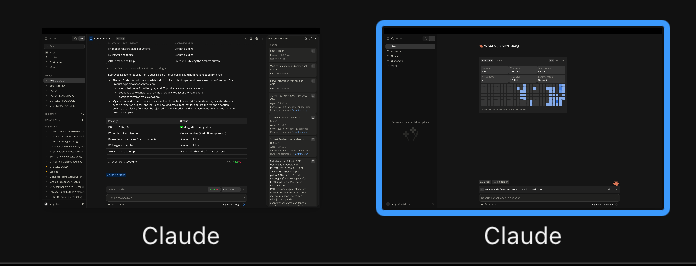
</p>

---

## 2. Giải pháp kiến trúc (The Solution)

Bộ công cụ `ai-profile` (cùng các lệnh tắt `claude-profile`, `agy-profile`, `codex-profile`, `grok-profile`) giải quyết triệt để ở cấp độ **Native macOS Application Bundle**:

| Hạng mục | Cách cũ (`osacompile` / `open -n -a`) | Giải pháp `multi-AI-profile` (Repo này) |
| :--- | :--- | :--- |
| **Tên cửa sổ trong AltTab / Mission Control** | ❌ Bị trùng tên gốc (`Claude`, `Antigravity`, `ChatGPT`, `Grok Bot`) | ✅ Tên riêng biệt (`Claude Work`, `Antigravity Work`, `Codex Work`, `Grok Work`) |
| **Icon trên Dock / Spotlight / Cmd+Tab** | ❌ Trùng icon gốc (hoặc bị `Assets.car` của macOS Sequoia đè lại) | ✅ Tự động gỡ `Assets.car` override & vẽ nhãn màu (`WORK`, `EXTRA`) nét căng lên `.icns` |
| **Dung lượng ổ cứng tốn thêm** | 0 MB | ✅ **0 MB** nhờ cơ chế **APFS Copy-on-Write (`cp -cR`)** dùng chung data blocks |
| **Thời gian tạo App mới** | ~2 giây | ✅ **< 1.5 giây** (nhân bản CoW + biên dịch Mach-O wrapper + đóng dấu icon) |
| **Cách ly tiến trình ngầm & CLI Home** | ❌ Dùng chung `~/.gemini`, `~/.codex`, `~/.grok`, `~/.grokbot` | ✅ Bọc cả UI Electron lẫn Daemon ngầm (`language_server`, `CODEX_HOME`, `GROK_HOME`, `SAND_DATA_ROOT`) |

### 5 bước kỹ thuật tự động bên dưới:

1. **Nhân bản Zero-Copy với APFS (`cp -cR`):** Clone nguyên bản `.app` từ `/Applications/` sang `~/Applications/<App> <Profile>.app` bằng cơ chế Copy-on-Write của APFS — tốn **0 MB** dung lượng thật và hoàn tất trong chưa đầy 1 giây. Tự động dọn dẹp các `osacompile` applet cũ bị trùng tên trong `/Applications` hoặc `~/Applications`.
2. **Patch `Info.plist`, `NSDockTilePlugIn` & toàn bộ Framework Helpers:** Đổi `CFBundleName`, `CFBundleDisplayName`, `CFBundleIdentifier` của cả app chính lẫn toàn bộ các tiến trình con (`*Helper (Renderer).app`, `Codex Framework.framework/Helpers/Codex (*.app)`), đồng thời loại bỏ khóa `CFBundleIconName`, `LSHasLocalizedDisplayName`, `NSDockTilePlugIn` (`CodexDockTilePlugin.docktileplugin`) và `CodexAppIconBaseName` để macOS WindowServer & Dock không bao giờ ghi đè tên hoặc icon lúc đang chạy.
3. **Biên dịch Native Mach-O Binary (`clang -O2` khớp kiến trúc `lipo -archs`):** Đổi tên binary gốc thành `*Real` và biên dịch một file thực thi C mỏng nhẹ gọi trực tiếp `execv()` kèm cờ `--user-data-dir` và các biến môi trường cô lập.
4. **Cách ly đa tầng (Multi-Layer Daemon & CLI Isolation) + Tự động Symlink Skills/Agents dùng chung:**
   - **Claude Desktop (`claude`):** Cô lập `--user-data-dir` (`~/Library/Application Support/Claude-<Profile>`), `CLAUDE_CONFIG_DIR` (`~/.claude-profiles/<slug>`) và `claude_desktop_config.json`; tự động symlink `CLAUDE.md`, `rules`, `agents`, `skills`, `commands`, `plugins` từ `~/.claude`.
   - **Google Antigravity (`antigravity` / `agy`):** Bọc **2 tầng Mach-O** cho cả `Contents/MacOS/Antigravity` (`--user-data-dir`) lẫn Go daemon `Contents/Resources/bin/language_server` (tự động lọc bỏ `--app_data_dir` mặc định từ Electron và ghi đè `--gemini_dir`, `--app_data_dir`, `--local_chrome_user_data_dir`), đồng thời symlink `GEMINI.md`, `skills`, `config/{skills,agents,plugins,hooks,rules}` từ `~/.gemini` và hỗ trợ `--share-auth`.
   - **OpenAI Codex / ChatGPT (`codex` / `chatgpt` / `codex-web`):** Cô lập `--user-data-dir`, `CODEX_ELECTRON_USER_DATA_PATH` và `CODEX_HOME` (`~/.codex-profiles/<slug>/config.toml` & `auth.json`), symlink `AGENTS.md`, `agents`, `skills`, `plugins` từ `~/.codex`. Với target `codex`, tự động kích hoạt bộ icon **Codex Dark (`>_`)** chính chủ ẩn bên trong bundle `ChatGPT.app`.
   - **xAI Grok Desktop (`grok`):** Cô lập `--user-data-dir`, `SAND_USER_DATA_DIR`, daemon socket `SAND_DATA_ROOT` (`~/.grokbot-profiles/<slug>`) và `GROK_HOME` (`~/.grok-profiles/<slug>/config.toml` & `auth.json`), symlink `agents`, `rules`, `skills`, `hooks` từ `~/.grok`.
   - **Cursor / Windsurf / Cline / Bất kỳ App nào (`--app`):** Tự động nhận diện `CFBundleExecutable`, `CFBundleIconFile`, bọc Mach-O `--user-data-dir` và đóng dấu icon.
5. **Tự động vẽ Pill Badge lên `.icns` & Ký số Ad-hoc (`codesign`):** Chuẩn hóa icon gốc về `1024×1024`, vẽ nhãn chữ nổi bật (`WORK`, `EXTRA`...) vào toàn bộ 10 kích thước chuẩn Apple Iconset, xóa `Assets.car` trong bản clone để tránh macOS Sequoia ghi đè icon, ký lại bằng `codesign --force --deep --sign -` và đăng ký ngay với `lsregister`.

---

## 3. Bộ sưu tập Logo & Hình ảnh thực tế (Logo & Visual Showcase)

### 3.1. Claude Desktop Profiles (`claude`)

<p align="center">
  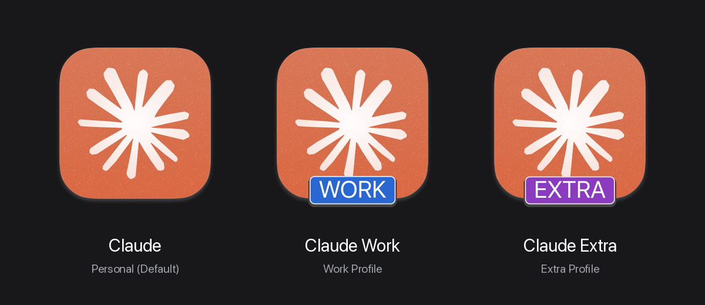
</p>

| Bản gốc (`Claude.app`) | Bản Công ty (`Claude Work.app`) | Bản Phụ (`Claude Extra.app`) |
| :---: | :---: | :---: |
| 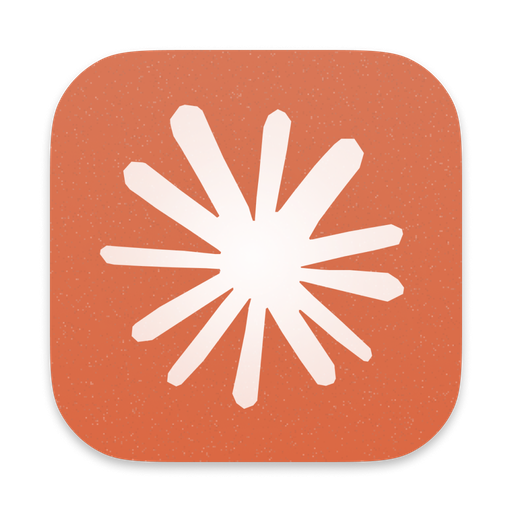 | 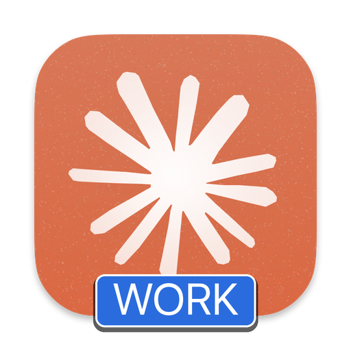 | 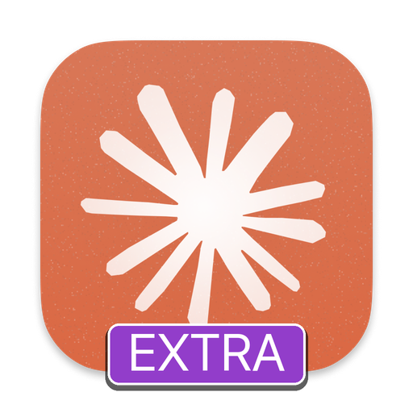 |
| `~/Library/Application Support/Claude` | `~/Library/Application Support/Claude-Work` | `~/Library/Application Support/Claude-Extra` |

### 3.2. Google Antigravity Profiles (`antigravity` / `agy`)

<p align="center">
  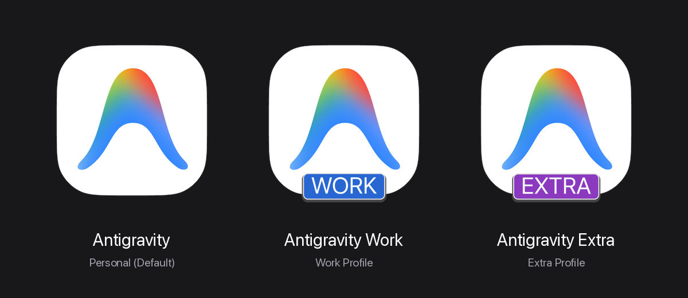
</p>

| Bản gốc (`Antigravity.app`) | Bản Công ty (`Antigravity Work.app`) | Bản Phụ (`Antigravity Extra.app`) |
| :---: | :---: | :---: |
|  | 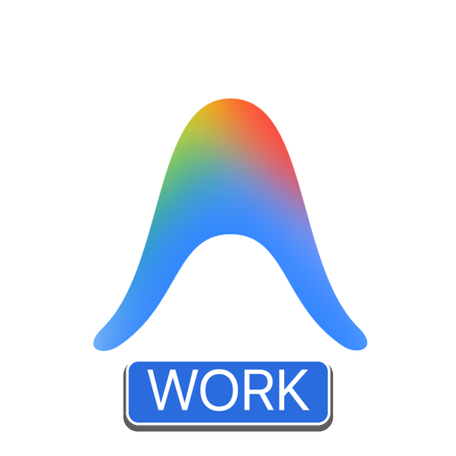 | 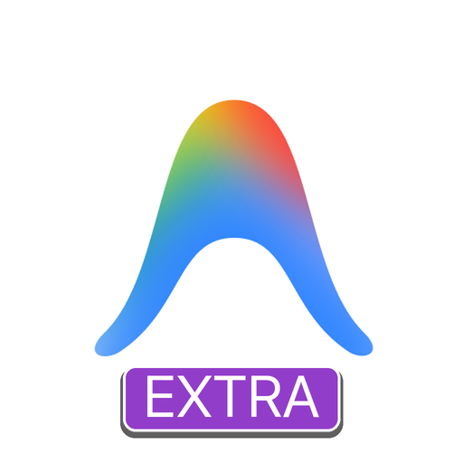 |
| `~/.gemini` | `~/.gemini-profiles/work` | `~/.gemini-profiles/extra` |

### 3.3. OpenAI Codex / ChatGPT Profiles (`codex` / `chatgpt`)

<p align="center">
  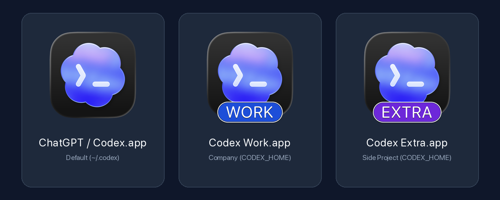
</p>

| Bản gốc (`ChatGPT / Codex.app`) | Bản Công ty (`Codex Work.app`) | Bản Phụ (`Codex Extra.app`) |
| :---: | :---: | :---: |
| 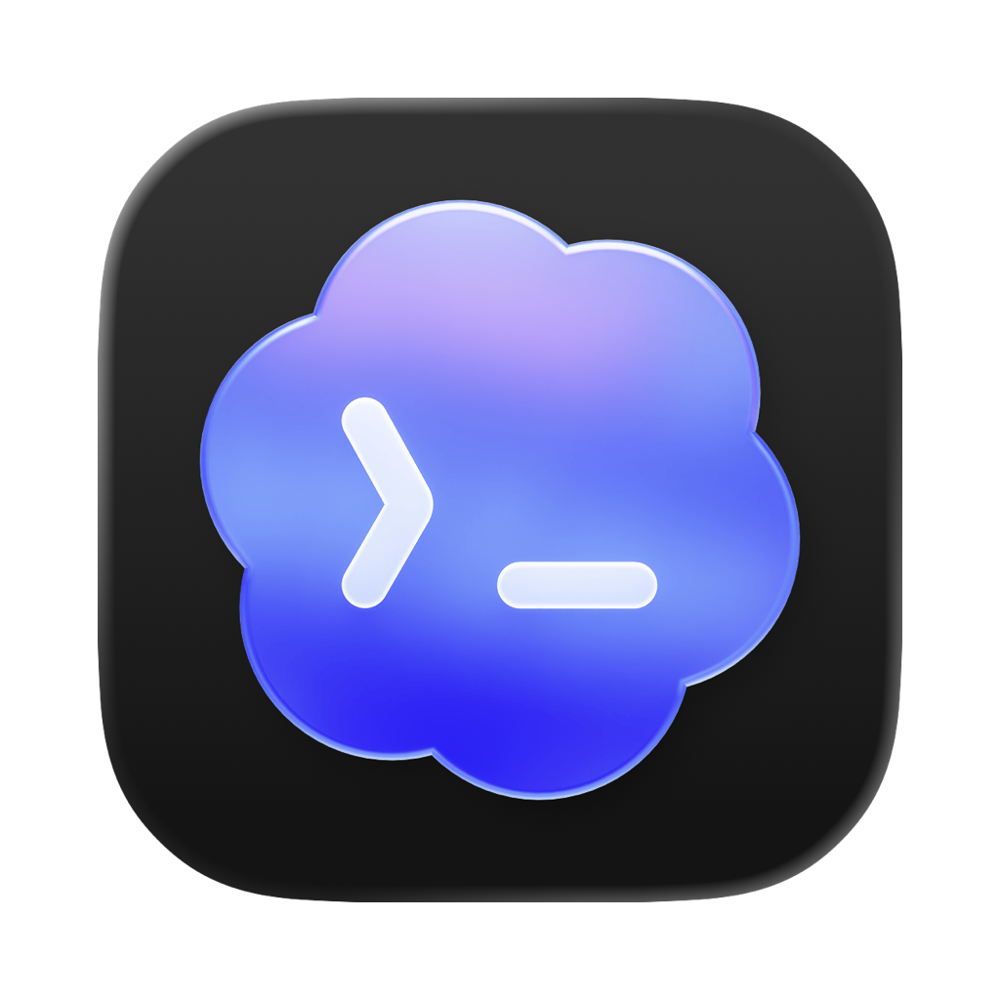 | 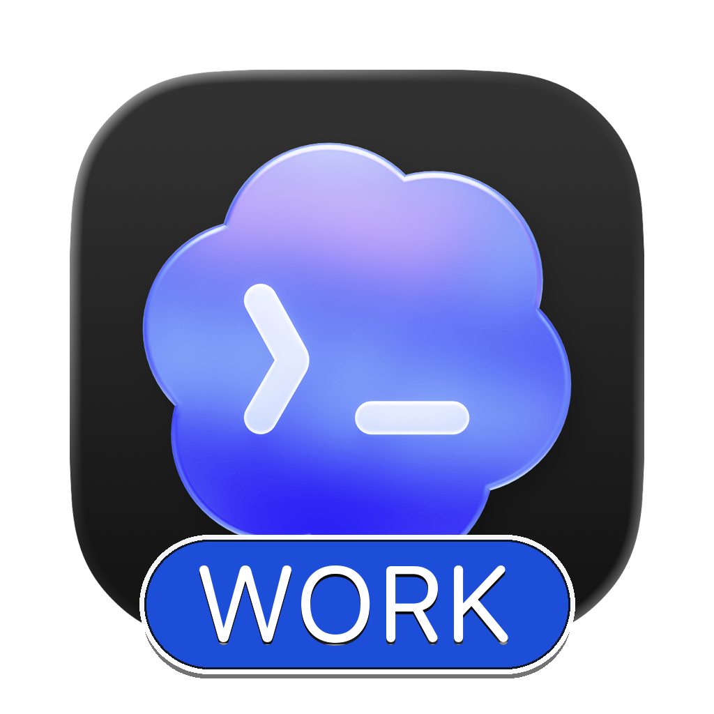 | 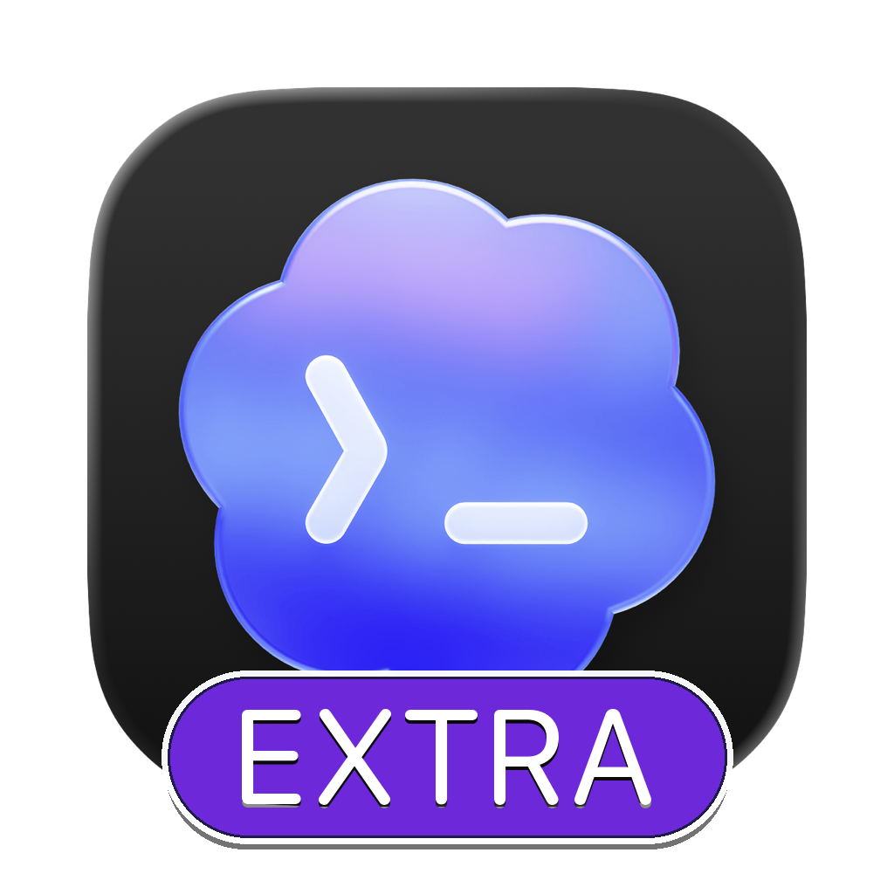 |
| `~/.codex` | `~/.codex-profiles/work` | `~/.codex-profiles/extra` |

### 3.4. xAI Grok Desktop Profiles (`grok`)

<p align="center">
  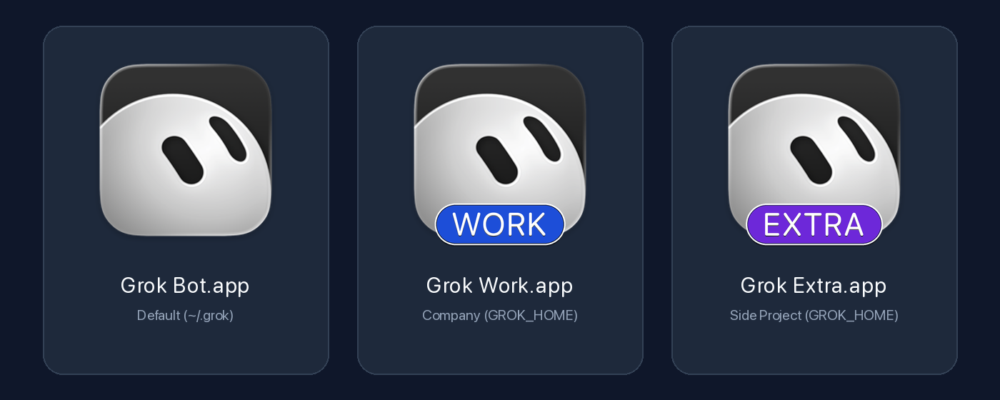
</p>

| Bản gốc (`Grok Bot.app`) | Bản Công ty (`Grok Work.app`) | Bản Phụ (`Grok Extra.app`) |
| :---: | :---: | :---: |
| 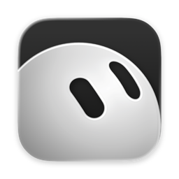 | 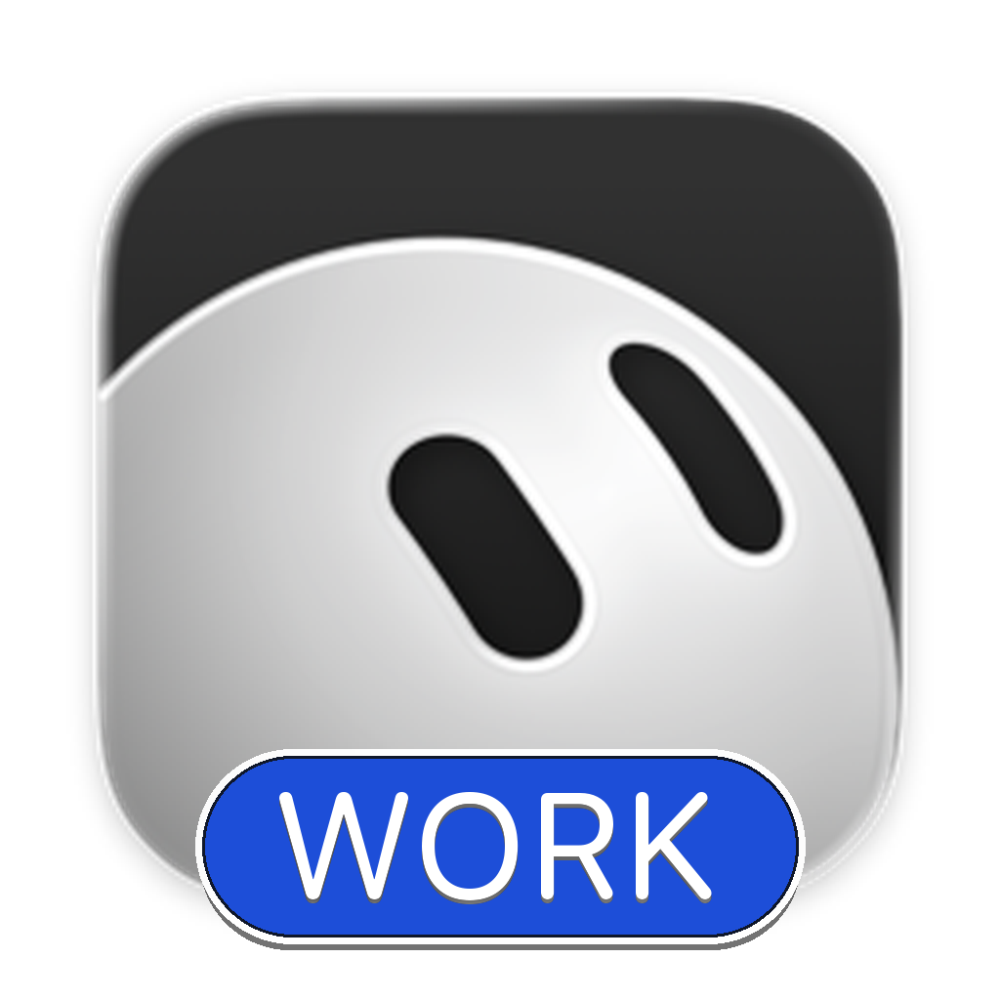 |  |
| `~/.grok` + `~/.grokbot` | `~/.grok-profiles/work` | `~/.grok-profiles/extra` |

### 3.5. Kết quả thực tế trong `~/Applications` & Màn hình đăng nhập độc lập

| Hiển thị trong `~/Applications` (Finder) | Màn hình Sign-in độc lập khi khởi chạy |
| :---: | :---: |
| 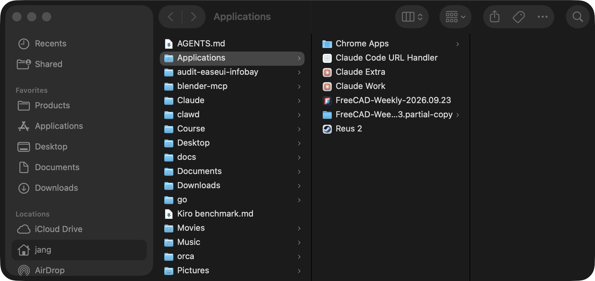 | 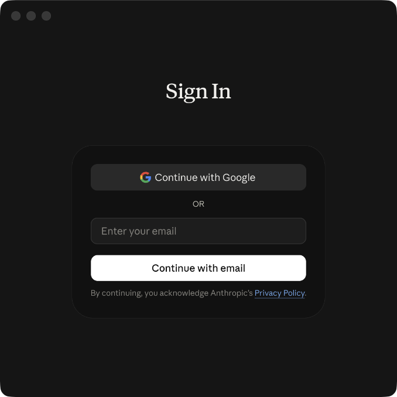 |

---

## 4. Cài đặt & Sử dụng nhanh (Quickstart)

### Bước 1: Cài đặt bộ CLI (`ai-profile`) và Agent Skill

```bash
git clone https://github.com/jangtrinh/multi-AI-profile.git
cd multi-AI-profile
./install.sh
```

*(Đảm bảo `~/.local/bin` đã có trong `PATH` của bạn, và máy đã cài đặt `Pillow` cho Python 3: `pip3 install --user Pillow`).*

### Bước 2: Tạo các ứng dụng AI độc lập bằng `ai-profile`

```bash
# 1. Tạo các bản Work (nhãn màu xanh dương) cho Claude, Antigravity, Codex, Grok
ai-profile create claude "Work" --color blue
ai-profile create antigravity "Work" --color blue
ai-profile create codex "Work" --color blue
ai-profile create grok "Work" --color blue

# 2. Tạo các bản Extra (nhãn màu tím)
ai-profile create claude "Extra" --color purple
ai-profile create antigravity "Extra" --color purple
ai-profile create codex "Extra" --color purple
ai-profile create grok "Extra" --color purple

# 3. Tạo cho Cursor, Windsurf, Cline hoặc bất kỳ ứng dụng Electron/Chromium nào trên máy
ai-profile create cursor "Work" --color emerald
ai-profile create custom "Work" --app "/Applications/Perplexity.app" --color cyan
```

*(Bạn cũng có thể dùng các lệnh tắt tương đương: `claude-profile`, `agy-profile`, `codex-profile`, `chatgpt-profile`, `grok-profile`, `cursor-profile`).*

### Bước 3: Kiểm tra sức khỏe (`doctor`), Nâng cấp Applet cũ (`migrate`), Liệt kê hoặc Gỡ bỏ Profile

```bash
# Kiểm tra toàn bộ dependencies, chữ ký số codesign và phát hiện osacompile applet cũ
ai-profile doctor
ai-profile doctor --fix

# Tự động nâng cấp toàn bộ các AppleScript (osacompile) applet cũ lên chuẩn Native Mach-O (giữ nguyên 100% dữ liệu)
ai-profile migrate

# Xem toàn bộ danh sách các AI profile đang có trên máy (hỗ trợ xuất --json cho Agent/CI)
ai-profile list
ai-profile list --json

# Tạo profile dùng chung tài khoản đăng nhập gốc nhưng tách riêng cửa sổ & lịch sử hội thoại
ai-profile create antigravity "Sandbox" --color cyan --share-auth

# Xóa app khỏi ~/Applications (mặc định giữ lại dữ liệu đăng nhập an toàn)
ai-profile remove codex "Extra"

# Xóa cả app lẫn toàn bộ dữ liệu đăng nhập của profile đó
ai-profile remove codex "Extra" --purge-data

# Chạy bộ kiểm thử tự động (Unit & Integration Tests)
python3 -m unittest discover -s tests -v
```

---

## 5. Bảng màu nhãn (Badge Color Presets)

| Tên màu (`--color`) | Mã Hex chính | Gợi ý sử dụng |
| :--- | :--- | :--- |
| `blue` | `#1D4ED8` | Tài khoản Công ty (`Work`, `Corp`) |
| `purple` | `#6D28D9` | Tài khoản Phụ / Dự án riêng (`Extra`, `Lab`) |
| `emerald` | `#047857` | Tài khoản Khách hàng / Freelance (`Client`) |
| `amber` | `#B45309` | Môi trường Staging / Testing (`Test`, `QA`) |
| `rose` | `#BE123C` | Tài khoản Admin / Ops (`Admin`, `Root`) |
| `cyan` | `#0E7490` | Tài khoản Nghiên cứu (`Research`) |
| `slate` | `#334155` | Tài khoản Lưu trữ / Backup (`Archive`) |
| `terracotta` | `#C2410C` | Tông màu cam đất truyền thống của Claude |

---

## 6. Tích hợp sẵn Agent Skill (`multi-ai-profile`)

Sau khi chạy `./install.sh`, skill `multi-ai-profile` (và alias `claude-multiprofile`) sẽ tự động được cài vào `~/.claude/skills/` và `~/.gemini/config/skills/`. Từ nay, bên trong **Claude Code**, **Codex** hoặc **Antigravity**, bạn chỉ cần gõ tự nhiên:

> *"Tạo thêm cho tôi 1 bản Codex tên là Client với icon màu emerald"*  
> *"Tạo thêm 1 ứng dụng Grok Work màu blue"*

Agent sẽ tự động gọi `ai-profile` và hoàn tất trong 2 giây mà không cần bạn nhớ cú pháp lệnh.

---

## License

Phát hành dưới giấy phép [PolyForm Shield 1.0.0](LICENSE): được dùng và sửa tự do, kể cả cho công việc có thu tiền; cấm bán lại hoặc làm sản phẩm cạnh tranh.
