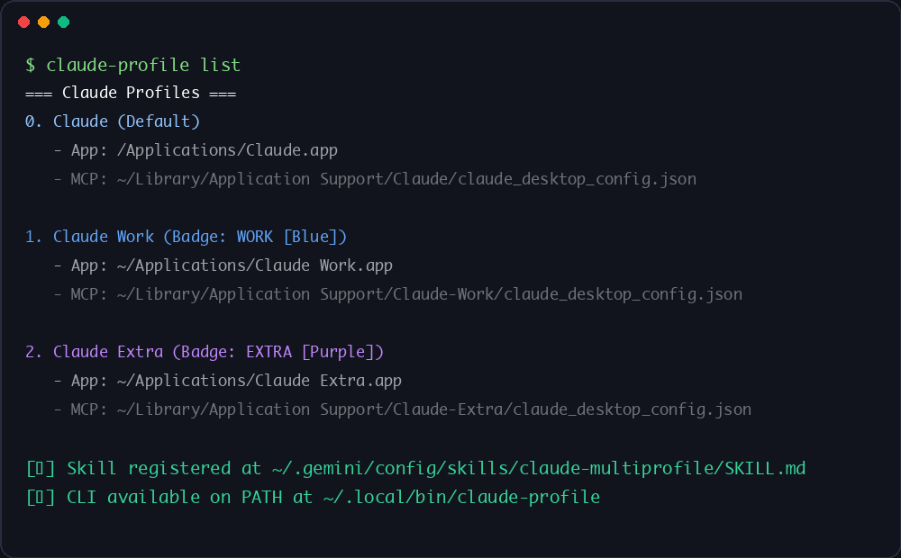

# Claude & Antigravity Multi-Profile (`claude-antigravity-multiprofile`)

**Run multiple isolated Claude Desktop and Google Antigravity accounts on macOS with custom window names, badged Dock icons, and zero disk overhead.**

Instant APFS copy-on-write macOS bundle cloner and Mach-O launcher that isolates accounts, MCP configs, and AltTab/Mission Control window names for Claude Desktop and Google Antigravity.

<p align="center">
  
</p>

<p align="center">
  <a href="LICENSE"></a>
  
  
  
  
  <a href="https://jangtrinh.github.io/claude-antigravity-multiprofile/"></a>
  <a href="https://buymeacoffee.com/jangtrinh"></a>
</p>

<p align="center">
  <a href="#1-nhu-cầu--vấn-đề-the-problem">Nhu cầu & Vấn đề</a> · <a href="#2-giải-pháp-kiến-trúc-the-solution">Giải pháp</a> · <a href="#3-bộ-logo--bằng-chứng-trực-quan-logo--visual-showcase">Logo Showcase</a> · <a href="#4-cài-đặt--sử-dụng-quickstart">Quickstart</a> · <a href="#5-cơ-chế-hoạt-động-under-the-hood">Cơ chế</a>
</p>

---

## 1. Nhu cầu & Vấn đề (The Problem)

Khi sử dụng **Claude Desktop** và **Google Antigravity** hàng ngày, rất nhiều kỹ sư có nhu cầu chạy **nhiều tài khoản song song** trên cùng một máy Mac:
- **Tài khoản 1 (Personal):** Dùng cho dự án cá nhân, gắn MCP servers cá nhân.
- **Tài khoản 2 (Work / Enterprise):** Dùng tài khoản công ty, gắn MCP servers nội bộ (Jira, Confluence, Database nội bộ) mà **không được phép lẫn sang profile cá nhân**.
- **Tài khoản 3 (Extra / Dev):** Dùng để test hoặc dự phòng khi hết quota.

### Tại sao cách tạo wrapper bằng `osacompile` / `open -n -a` thông thường bị lỗi nhận diện?

Cách phổ biến thường được chia sẻ là dùng `osacompile` gọi lệnh:
```bash
open -n -a "Claude" --args --user-data-dir="$HOME/Library/Application Support/Claude-Work"
```

Cách này tuy mở được 2 cửa sổ nhưng vì vẫn gọi trực tiếp vào bundle gốc `/Applications/Claude.app`, macOS WindowServer sẽ coi tất cả cửa sổ đều thuộc về cùng một app tên là **`Claude`** với cùng một icon giống hệt nhau. Khi bấm **`Cmd + Tab`**, **AltTab**, hoặc **Mission Control**, bạn không thể phân biệt cửa sổ nào là Personal, cửa sổ nào là Work:

<p align="center">
  
</p>

---

## 2. Giải pháp kiến trúc (The Solution)

Bộ công cụ **`claude-profile`** và **`agy-profile`** giải quyết triệt để bằng cách tạo **Standalone macOS Application Bundle** thực thụ cho từng profile chỉ với 1 lệnh:

| Tiêu chí | Cách `osacompile` / `open -n -a` cũ | `claude-profile` & `agy-profile` (Repo này) |
| :--- | :--- | :--- |
| **Tên hiển thị trên AltTab / Cmd+Tab / Mission Control** | Tất cả cửa sổ đều bị trùng tên là `Claude` | Hiển thị tên riêng biệt: **`Claude`**, **`Claude Work`**, **`Claude Extra`**, **`Antigravity Work`** |
| **Icon trên Dock / Spotlight / Finder** | Trùng 1 icon duy nhất hoặc dính icon AppleScript | Tự động gắn **Badge màu nổi bật** (`WORK`, `EXTRA`, `DEV`) chuẩn `.icns` đa độ phân giải |
| **Dung lượng ổ cứng tiêu tốn** | ~0 MB | **0 MB** — Dùng cơ chế APFS Copy-on-Write (`cp -cR`) clone bundle 650MB trong 0.8 giây mà không tốn thêm dung lượng |
| **Cấu hình MCP Server** | Dễ bị lẫn hoặc phải sửa tay | Mỗi profile có file `claude_desktop_config.json` / `mcp_config.json` độc lập hoàn toàn |
| **Hỗ trợ Google Antigravity (2 tầng)** | Không tách được tài khoản Google (vì `language_server` đọc chung `~/.gemini`) | Bọc cả 2 tầng (**Electron Frontend** + **Go `language_server`**) để tách riêng token OAuth Google (`jetski-standalone-oauth-token`) nhưng **tự động symlink toàn bộ `GEMINI.md`, `skills`, `agents`, `plugins`** từ `~/.gemini` gốc |

---

## 3. Bộ Logo & Bằng chứng trực quan (Logo & Visual Showcase)

### 3.1. Bộ Icon Claude Desktop (`claude-profile`)

<p align="center">
  
</p>

| `Claude (Default)` | `Claude Work` (`--color blue`) | `Claude Extra` (`--color purple`) |
| :---: | :---: | :---: |
|  |  |  |
| `/Applications/Claude.app` | `~/Applications/Claude Work.app` | `~/Applications/Claude Extra.app` |
| `Application Support/Claude` | `Application Support/Claude-Work` | `Application Support/Claude-Extra` |

### 3.2. Bộ Icon Google Antigravity (`agy-profile`)

<p align="center">
  
</p>

| `Antigravity (Default)` | `Antigravity Work` (`--color blue`) | `Antigravity Extra` (`--color purple`) |
| :---: | :---: | :---: |
|  |  |  |
| `/Applications/Antigravity.app` | `~/Applications/Antigravity Work.app` | `~/Applications/Antigravity Extra.app` |
| `~/.gemini` | `~/.gemini-profiles/Work` | `~/.gemini-profiles/Extra` |

### 3.3. Hiển thị thực tế trong Finder, Terminal & Cửa sổ đăng nhập độc lập

<p align="center">
  
</p>

<p align="center">
  
</p>

<p align="center">
  
</p>

---

## 4. Cài đặt & Sử dụng (Quickstart)

### Bước 1: Cài đặt một lần (`Install once`)

```bash
git clone https://github.com/jangtrinh/claude-antigravity-multiprofile.git
cd claude-antigravity-multiprofile
./install.sh
```

*(Lệnh `./install.sh` sẽ cài `claude-profile` và `agy-profile` vào `~/.local/bin` đồng thời cài luôn Agent Skill `claude-multiprofile` vào `~/.claude/skills/` và `~/.gemini/config/skills/`).*

### Bước 2: Tạo Profile cho Claude Desktop

```bash
# Tạo app "Claude Work.app" với badge WORK màu xanh dương
claude-profile create Work --color blue

# Tạo app "Claude Extra.app" với badge EXTRA màu tím
claude-profile create Extra --color purple

# Xem danh sách tất cả profile & đường dẫn file claude_desktop_config.json
claude-profile list

# Xóa app profile (vẫn giữ nguyên dữ liệu đăng nhập & MCP config để an toàn)
claude-profile delete Extra
```

### Bước 3: Tạo Profile cho Google Antigravity

```bash
# Chế độ 1 (Mặc định): Tách tài khoản Google riêng + MCP riêng + Tự động symlink toàn bộ skills/agents/rules từ ~/.gemini
agy-profile create Work --color blue

# Chế độ 2 (--share-auth): Dùng chung tài khoản Google hiện tại nhưng tách riêng cửa sổ & lịch sử hội thoại
agy-profile create Extra --color purple --share-auth

# Xem danh sách hoặc xóa app profile
agy-profile list
agy-profile delete Extra
```

**12 màu badge hỗ trợ sẵn:** `blue`, `purple`, `green`, `emerald`, `orange`, `amber`, `red`, `pink`, `cyan`, `teal`, `gray`, `dark`.

---

## 5. Cơ chế hoạt động (Under the Hood)

1. **APFS Copy-on-Write Clone (`cp -cR`):** Sao chép tức thời `/Applications/Claude.app` hoặc `/Applications/Antigravity.app` sang `~/Applications/<App> <Name>.app` ở tầng metadata của hệ thống file APFS (0 MB dung lượng phát sinh, hoàn tất dưới 1 giây).
2. **Đổi tên Framework Helpers:** Electron trên macOS kiểm tra tên `Contents/Frameworks/<CFBundleDisplayName> Helper*.app`. Công cụ tự động đổi tên toàn bộ các Helper bundles (`GPU`, `Plugin`, `Renderer`, main helper) và cập nhật `Info.plist` bên trong để khớp với tên mới (`Claude Work`, `Antigravity Work`).
3. **Biên dịch Native Mach-O `execv()` Launcher:** Thay vì dùng bash script dễ làm mất bundle context của macOS WindowServer, công cụ dùng `clang` biên dịch một binary Mach-O gọn nhẹ giữ nguyên PID và truyền `--user-data-dir` (cùng `--gemini_dir` cho `language_server` của Antigravity).
4. **Tạo Icon `.icns` & Xóa `Assets.car`:** Trên macOS Sonoma/Sequoia, `Assets.car` và khóa `CFBundleIconName` trong `Info.plist` sẽ ghi đè file `.icns`. Công cụ tự động gỡ bỏ `Assets.car`, vẽ pill badge độ tương phản cao lên icon 1024x1024 gốc bằng Pillow, đóng gói thành bộ `.icns` chuẩn Retina qua `iconutil`, ký lại chữ ký ad-hoc (`codesign --force --deep --sign -`) và đăng ký ngay với `lsregister`.

---

## License

Released under the [MIT License](LICENSE). Created by [Jang Trịnh (@jangtrinh)](https://github.com/jangtrinh).
